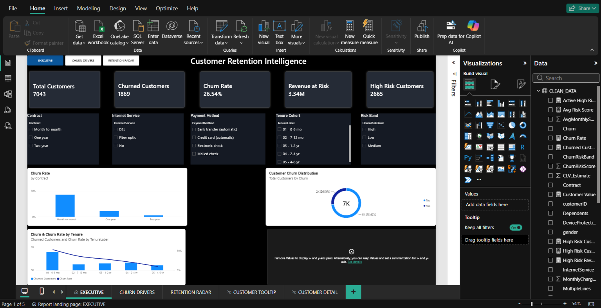

# CHURN//IQ — Customer Retention Intelligence

An end-to-end customer churn analytics project built using Excel, PostgreSQL (Supabase), SQL, and Power BI.

CHURN//IQ analyzes customer churn patterns, identifies customer segments associated with higher churn, estimates customer value exposure, and prioritizes active high-risk customers for retention efforts.

> **Project type:** Descriptive analytics and rule-based risk segmentation. This project is not presented as a validated machine-learning churn prediction model.

---

## 📊 Dashboard Preview

### 1. Executive Command Center

Provides an overview of customer volume, churn performance, customer value exposure, and customer risk.

### 2. Churn Drivers

Compares observed churn rates across contract types, payment methods, internet services, technical support, online security, and paperless billing.

### 3. Retention Radar

Highlights high-risk customers, estimated customer value by risk band, and active customers who may be prioritized for retention.

---

## 🎯 Business Problem

A telecommunications business needs to understand where customer churn is concentrated and how to prioritize retention efforts.

This project investigates churn patterns across customer and service characteristics, then uses customer risk bands and estimated customer lifetime value (CLV) to support retention prioritization.

## 📁 Dataset

The analysis uses the IBM Telco Customer Churn dataset.

- **Total customers:** 7,043
- **Customers who churned:** 1,869
- **Overall churn rate:** 26.54%

Data preparation included customer-ID duplicate checks, data-type handling, cleaning, and feature preparation.

## 🛠️ Tools and Technologies

- **Microsoft Excel:** Initial data preparation and quality checks
- **Power Query:** Data transformation and feature preparation
- **PostgreSQL / Supabase:** Online SQL analysis and validation
- **SQL:** Aggregation, segmentation, churn-rate calculations, and retention-target extraction
- **Power BI:** Interactive dashboards, DAX measures, slicers, tooltips, and drill-through

---

## 📈 Dashboard Pages

### Executive Command Center

Provides the overall customer and churn KPIs, contract analysis, customer churn distribution, tenure-cohort analysis, and the Customer Economic & Risk Map.

### Churn Drivers

Examines observed churn rates by:

- Contract
- Payment method
- Internet service
- Tech support
- Online security
- Paperless billing

### Retention Radar

Shows customer counts and estimated value by risk band, with a detailed table of active high-risk customers ranked by estimated customer value.

The report also includes a customer tooltip and a Customer Detail drill-through page.

---

## 🔍 Key Findings

### 1. Contract Type

Month-to-month customers have an observed churn rate of **42.71%**, compared with **2.83%** among two-year contract customers.

### 2. Payment Method

Customers using electronic checks have an observed churn rate of **45.29%**, compared with **15.24%** among customers using automatic credit-card payments.

### 3. Internet Service

Fiber-optic customers have an observed churn rate of **41.89%**, compared with **18.96%** for DSL customers and **7.40%** for customers without internet service.

### 4. Customer Tenure

Customers in the 0–6 month cohort have an observed churn rate of **52.94%**, compared with **9.51%** among customers in the 4–6 year cohort.

### 5. Combined Customer Segment

The combination of **month-to-month contract, electronic-check payment, and 0–6 months of tenure** has an observed churn rate of **67.65%**: 460 of 680 customers in this segment churned.

These findings describe associations in the dataset. They do not prove that any individual factor causes churn.

---

## 💰 Retention Opportunity

The current risk-band classification identifies:

| Metric | Result |
|---|---:|
| Customers classified as high risk | 2,665 |
| Estimated value across high-risk customers | 4.78M |
| Active high-risk customers | 1,246 |
| Estimated value of active high-risk customers | 2,167,831.20 |

The active high-risk segment is particularly useful for retention prioritization because these customers have not yet churned.

The dashboard's **Revenue at Risk** measure sums estimated CLV for customers whose observed churn status is `Yes`. It is an estimated customer-value measure, not a verified accounting revenue figure.

---

## 💡 Business Recommendations

1. **Improve early customer engagement:** Prioritize onboarding and engagement for customers in their first six months.
2. **Review month-to-month retention:** Investigate retention strategies for customers without longer-term contracts.
3. **Investigate payment experience:** Examine billing experience and payment preferences among electronic-check customers.
4. **Target combined segments:** Use combinations of customer characteristics to identify segments for further investigation.
5. **Prioritize active high-risk customers:** Use estimated customer value to organize retention outreach and evaluate the effectiveness of retention campaigns.

These are recommendations based on observed patterns, not proven causal effects.

---

## 🗄️ SQL Analysis

The SQL scripts cover:

- Data and customer-ID validation
- Overall churn calculations
- Churn by contract, payment method, internet service, and tenure cohort
- Active high-risk customer prioritization
- Customer-value summaries
- Combined contract, payment, and tenure segmentation

See [`sql/README.md`](sql/README.md) for the SQL documentation.

The repository also contains ten individual SQL scripts and `CHURN_IQ_SQL_Scripts.zip`.

The queries were run against the Supabase PostgreSQL table `public.telco_churn`.

---

## 📊 Power BI Report

Download the interactive Power BI report:

**[CHURN_IQ_Final.pbix](powerbi/CHURN_IQ_Final.pbix)**

Open the file in Power BI Desktop to explore the report pages and interactions.

The report includes:

- Interactive slicers
- Customer Economic & Risk Map
- Custom customer tooltip
- Customer-detail drill-through
- Customer value and risk segmentation
- Three main dashboard pages

---

## ⚠️ Limitations

- The analysis is descriptive and uses observational customer data.
- The original methodology used to produce `ChurnRiskScore` and `ChurnRiskBand` has not been verified.
- These risk fields should not be described as a validated predictive model.
- Customer-value estimates should not be interpreted as audited revenue.
- The findings indicate associations, not causation.

---

## 🚀 Future Improvements

- Audit and document the existing risk-score methodology.
- Build and evaluate a separate churn-prediction model without target leakage.
- Assess predictive performance on unseen data.
- Test retention strategies and measure their actual impact.
- Develop a repeatable process for refreshing the dataset and dashboard.

---

## Project Summary

CHURN//IQ combines data cleaning, SQL analysis, customer segmentation, and interactive Power BI reporting to turn churn data into practical retention-prioritization insights.
